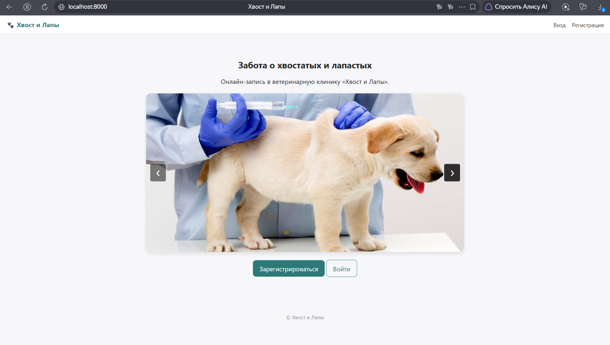
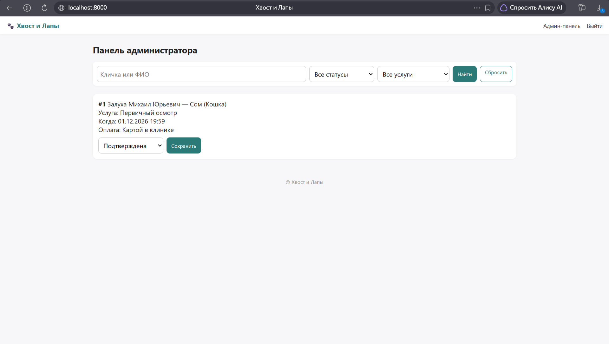
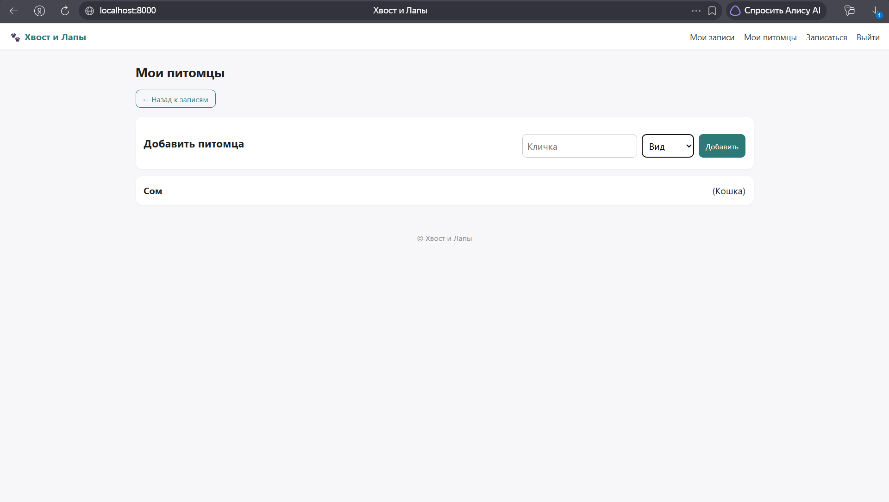
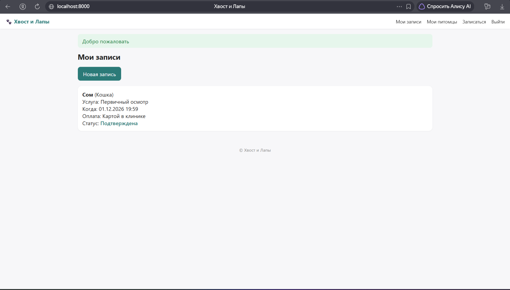
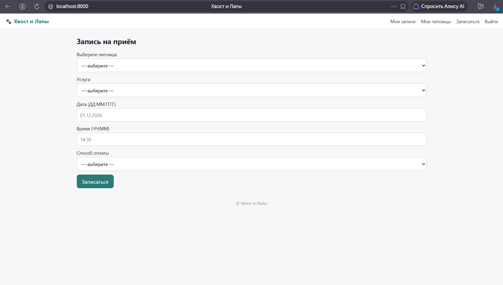

# Учебная практика: Портал «Хвост и Лапы» (Вариант 4)

**Предметная область:** Информационная система ветеринарной клиники для онлайн-записи на приём.
**Специальность:** 09.02.07 «Информационные системы и программирование» (Подготовка к демоэкзамену).

## 🛠 Технологический стек
*   **Бэкенд:** PHP 8.x (ООП, классы), PDO.
*   **База данных:** SQLite (автоматическое создание при первом запуске).
*   **Фронтенд:** HTML5, CSS3 (адаптивная верстка), Vanilla JavaScript.
*   **Контроль версий:** Git (работа велась в ветках `module-1`, `module-2`, `module-3`).

## Структура проекта
Проект разделен согласно строгим требованиям (без смешивания логики и представления):
*   `index.php` — единственная точка входа (главная страница).
*   `frontend/` — все страницы интерфейса (только `.php` файлы). Внутри лежат `assets/` и `partials/`.
*   `backend/` — вся логика: классы, обработчики форм (`actions/`), настройки и база данных (`database/`).

## Как запустить проект
1. Убедитесь, что у вас установлен PHP 8.x (и включено расширение `pdo_sqlite`).
2. В корне проекта выполните команду: `php -S localhost:8000`
3. Откройте в браузере `http://localhost:8000`.
4. База данных SQLite (`app.sqlite`) создастся автоматически при первом обращении.

### Доступ для администратора
При первом запуске база данных автоматически создает администратора.
*   **Логин:** `Admin`
*   **Пароль:** `VetLapa1`

## Реализованный функционал по модулям
### Модуль 1. Проектирование и разработка ИС
*   Спроектирована БД (5 таблиц, внешние ключи).
*   Реализована регистрация и авторизация с серверной валидацией.
*   Пароли хранятся в виде хэша (`password_hash`).
*   Реализована подача заявок, личный кабинет, отзывы (только после завершения приема).
*   Создана панель администратора.

### Модуль 2. Разработка дизайна веб-приложений
*   Адаптивный слайдер на главной (4 фото, автопрокрутка).
*   Форма записи дополнена списками (виды, услуги).
*   Серверная валидация даты и времени (09:00 - 20:00).
*   В админ-панели реализованы поиск, фильтрация и пагинация.

### Модуль 3. Проектирование, разработка и оптимизация
*   Питомцы вынесены в отдельную таблицу `pets`.
*   Клиентская и серверная проверка рабочих часов.
*   Возможность отмены заявки пользователем.
*   Адаптив под планшеты и ПК, CSS-анимации карточек и кнопок.

## Скриншоты приложения

**Главная страница (слайдер)**

**Панель администратора (фильтры и пагинация)**

**Мои питомцы**

**Мои записи**

**Форма записи на прием**

---
*Работа выполнена в рамках подготовки к демонстрационному экзамену по стандартам КОД 09.02.07-3-2026.*